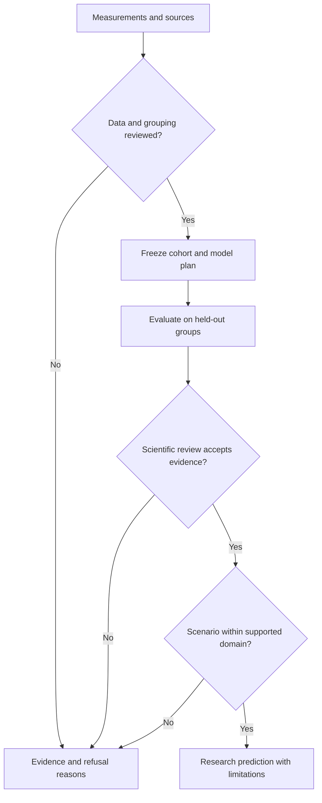

# IGNIS ML Lead briefing

You now have a tested research pipeline that can compare three models fairly and refuse to predict when the evidence is inadequate. You do **not** yet have a validated NASA flame-spread predictor. That distinction is the most important part to explain to your team and judges.

## 1. What was built?

A Python package checks measurement meaning, units, provenance and experimental identities; selects a reviewed comparable cohort; evaluates a mean baseline and two Ridge models on independent groups; exports errors, residuals, plots and JSON; and gates predictions using review and evidence-domain checks.

The implementation runs on CPU with ordinary scientific Python libraries. Sixty-four automated tests were executed successfully for this delivery. The synthetic demonstration contains 72 invented measurements in 12 invented runs, with six related observations per run. No NASA observations were fitted.

## 2. How does a CSV become a prediction?

A format check is not scientific validation. For example, a spreadsheet can contain a number in every cell while its 23 rows actually represent repeated measurements from a few burns. The pipeline needs the real dependence structure before judging predictive performance.

## 3. What is the prediction target?

Flame-spread rate describes how fast the flame front advances along the fuel. If a front travels 1 cm in 5 s, its average spread rate is 0.2 cm/s. This is a kinematic example, not a NASA measurement. A steady flame size of 4 cm is a length; it does not specify how far the front travels per second. The current four-row comparison table therefore cannot supply this regression target.

## 4. How does the naive baseline work?

The mean baseline predicts:

\[
\hat y = \frac{1}{n_{\mathrm{train}}}\sum_{i=1}^{n_{\mathrm{train}}} y_i.
\]

Here, \(\hat y\) is the predicted spread rate in cm/s; \(n_{\mathrm{train}}\) is the number of training observations; \(i\) labels a training observation; and \(y_i\) is its measured spread rate in cm/s. The summation means “add all training rates.”

If training measurements are 0.1, 0.2 and 0.3 cm/s, the baseline predicts 0.2 cm/s for every held-out scenario. It is intentionally simple: if a complex model cannot beat it on independent data, the extra complexity has not demonstrated predictive value. Each fold calculates its own training mean; the held-out measurements never enter it.

## 5. What does Ridge regression do?

The model predicts a weighted sum of features:

\[
\hat y_i=b+\sum_{j=1}^{p}w_j z_{ij}.
\]

Here, \(\hat y_i\) is the predicted spread rate for observation \(i\), in cm/s; \(b\) is the intercept in cm/s; \(p\) is the number of transformed input features; \(j\) labels a feature; \(w_j\) is its fitted weight; and \(z_{ij}\) is the transformed value of feature \(j\) for observation \(i\). Numeric features are standardized using training-fold statistics; categories become indicator columns. Thus these transformed features are dimensionless, and their weights have units of cm/s.

For a nonconstant numeric feature, standardization is:

\[
z_{ij}=\frac{x_{ij}-\mu_j}{s_j}.
\]

Here, \(x_{ij}\) is the original numerical input, \(\mu_j\) is its training-fold mean, and \(s_j\) is its training-fold standard deviation. The three quantities have the same original units, so the ratio has no units. A constant training feature is handled by scikit-learn without division by zero. Its constancy does not justify prediction at a new value.

Ridge chooses the intercept and weights to minimize:

\[
\sum_{i=1}^{n_{\mathrm{train}}}(y_i-\hat y_i)^2+\alpha\sum_{j=1}^{p}w_j^2.
\]

The symbols \(i,j,n_{\mathrm{train}},y_i,\hat y_i,p,w_j\) retain their meanings above; \(\alpha\) is the positive regularization strength. The first term penalizes prediction errors on training observations. The second penalizes large weights. With the stated transformed features, both sums have squared-rate units and \(\alpha\) is dimensionless in this implementation. The intercept is not penalized. The demo fixes \(\alpha=1\) before evaluation.

Regularization can reduce unstable fits, especially when features overlap in information. It does not repair wrong labels, missing conditions, non-independent tests, or confounded experiments. Ridge can also produce negative rates; the prediction interface refuses those instead of quietly clipping them to zero.

## 6. Why keep whole experiments together?

Suppose one burn produces ten measurements at different times. Splitting five into training and five into testing lets the model benefit from shared fuel, apparatus and unmeasured conditions. The test then asks whether the model recognizes another part of a familiar experiment, rather than whether it generalizes to a new one.

IGNIS groups related measurements together. Leave-one-group-out trains on all other groups and tests on the remaining group, repeating for each group. Campaign holdout asks a harder question about new campaign conditions. Cross-scale holdout reserves a predeclared investigation as the test set, but only after comparability and independence are established.

A run ID is necessary but not sufficient: specimen reuse or common repeat-series effects may require grouping several runs together. The Data Lead and Scientific Lead must document that. The software checks consistency and overlap; it cannot infer independence just from a name.

## 7. What are MAE and RMSE?

\[
\mathrm{MAE}=\frac1n\sum_{i=1}^n|y_i-\hat y_i|,
\qquad
\mathrm{RMSE}=\sqrt{\frac1n\sum_{i=1}^n(y_i-\hat y_i)^2}.
\]

Here, MAE means mean absolute error; RMSE means root mean squared error; \(n\) is the number of held-out observations; \(i\) identifies one held-out observation; \(y_i\) is its measured rate; and \(\hat y_i\) is its predicted rate. Both errors are in cm/s. Absolute-value bars make a difference nonnegative; squaring also makes it nonnegative but gives large errors more influence.

For errors of 0.1 and 0.3 cm/s, MAE is 0.2 cm/s and RMSE is about 0.224 cm/s. Lower is better only when models are evaluated on the same legitimate test observations. These numbers do not mean “percent accuracy” and do not measure uncertainty in the original experiment.

The report also gives error per independent group and equal-group averages, so a run with many observations does not completely dominate the story.

## 8. What makes a feature physically motivated?

A feature is physically motivated when the Scientific Lead can explain why it might relate to the process and verify its measurement definition. Specimen width describes the fuel's transverse extent. A confinement dimension describes nearby boundaries. A ratio can express relative size, but its predictive role is still a hypothesis.

For the optional ratio:

\[
r=\frac{W}{H},
\]

\(r\) is a dimensionless geometry ratio; \(W\) is verified specimen width in cm; and \(H\) is a consistently defined verified duct height in cm. A sample-to-wall gap is not automatically the same \(H\). The current audit leaves that geometry unresolved, so this ratio is disabled by default and must not be calculated from the old candidate heights for modeling.

Adding width to Ridge does not impose conservation laws or solve heat-transfer equations. Call it a “geometry-aware, physically motivated regression,” and explain the limits of “physics-informed” if you use that phrase.

## 9. What would count as improvement?

A predeclared geometry model should reduce error against both the mean baseline and condition-only model across independent, comparable tests. The benefit should not disappear when one campaign is removed or be attributable to oxygen/material/apparatus changing at the same time as width. More independent campaigns and uncertainty analysis may be needed before a convincing conclusion.

In the synthetic fixture, the generator deliberately contains a width effect. Geometry Ridge therefore performs well by design. That verifies the model comparison machinery; it cannot answer whether geometry helps the actual NASA problem. Never show those scores without the synthetic label.

## 10. When should IGNIS abstain?

When no reviewed model exists; provenance or essential inputs are missing; material, direction or regime is unseen; conditions or dimensions lie outside observed coverage; the combination lacks nearby evidence; geometry definitions differ; or the model produces an invalid rate. A lunar scenario is not covered by microgravity evidence merely because its pressure and oxygen match.

`LIMITED_EVIDENCE` means related observations can still be shown without a number. `UNSUPPORTED` means the request cannot be responsibly predicted by the available model/evidence. `SUPPORTED` is a narrow research-domain state, never a statement that a spacecraft configuration is safe.

## 11. What should you tell judges?

“Our system tests whether verified geometry improves prediction on independent experiments. It compares simple baselines fairly, keeps related measurements together, and shows when the data do not support a numerical answer. We have implemented and tested the full workflow with clearly labeled synthetic data. Our current NASA audit has zero approved modeling rows, so we do not claim validated cross-scale accuracy.”

Be ready to show the original-versus-canonical data mapping, a blocked current-data report, a fold membership report, the synthetic figures, and an out-of-domain refusal. Explain that recovering trustworthy experimental identities is part of doing the science, not administrative cleanup.

## 12. What do you do next?

Read the compatibility report with the Data Lead, confirm the canonical contract with the Scientific Lead, and connect the JSON examples to the frontend now. Use the commands in the README to reproduce tests/demo on your M2. When reviewed data arrives, follow `DATA_REQUIREMENTS.md`, freeze the study configuration, evaluate, and review the result before enabling any real prediction. If the data remains inadequate, the evidence-and-abstention version is the scientifically defensible project outcome.
